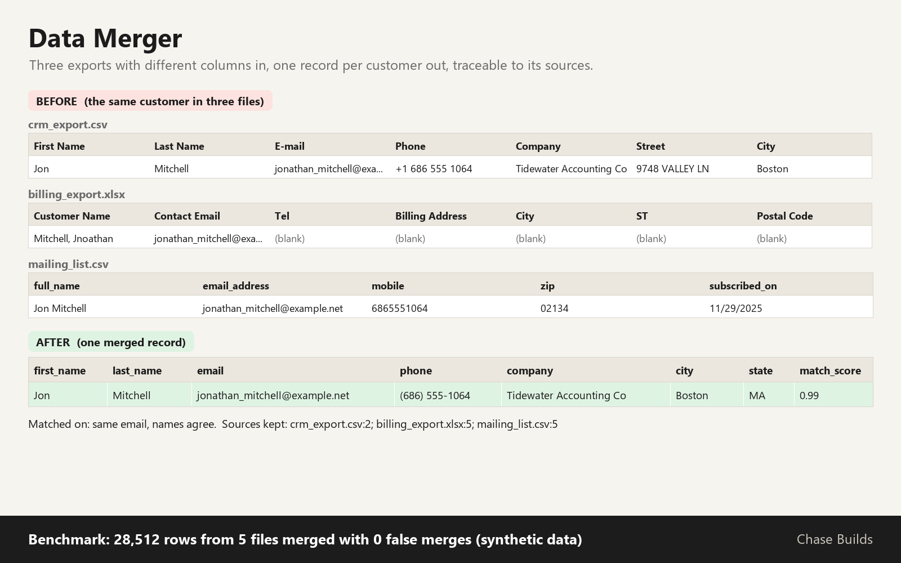

# data-merger

[](https://github.com/chasebuilds/data-merger/actions/workflows/ci.yml)  [](LICENSE)

Turns several overlapping customer lists (CSV or Excel, different headers, different formats) into one workbook where each real-world record appears once and every value can be traced back to the file and row it came from.



## Measured result

Scored against generated data where the right answer is known. The table below is written by the benchmark script from a real run, not typed by hand. Full report, precision by match reason, and its limits: [BENCHMARK.md](BENCHMARK.md).

<!-- benchmark:start -->
| Measure | 2,898 source rows | 28,512 source rows |
|---|---:|---:|
| Source files | 5 | 5 |
| Real-world entities in the truth table | 1,000 | 10,000 |
| True matching pairs | 3,427 | 32,797 |
| Auto-merged pairs | 3,074 | 29,231 |
| **Auto-merge precision** (pairs) | **100.00%** | **100.00%** |
| **Auto-merge recall** (pairs) | **89.70%** | **89.13%** |
| **False merges** (wrong pairs auto-merged) | **0** | **0** |
| Merged records that mix two entities | 0 | 0 |
| True pairs sent to Review instead | 249 | 2,506 |
| True pairs missed with no flag | 104 | 1,060 |
| Review pairs for a human to check | 109 | 1,337 |
| Review pairs that are real matches | 104 | 1,134 |
| Pairs compared after blocking | 7,105 of 4,197,753 | 345,282 of 406,452,816 |
| Blocking recall (true pairs that were compared at all) | 99.65% | 99.71% |
| Run time: match and resolve | 0.4 s | 3.9 s |
| Run time: write workbook | 0.8 s | 7.3 s |
<!-- benchmark:end -->

A false merge (two different people glued into one record) is the costly error, so the tool is tuned to send doubtful pairs to a review sheet instead of merging them. An earlier version made one false merge on this benchmark; BENCHMARK.md shows it, the rule added for it, and what that rule cost in recall.

These numbers describe generated data only. On a client's files, match quality is measured per job with the audit sample described below.

## Before and after

Four rows in three sample files describe one customer. None of them agree on format.

| File and row | Name | Email | Phone | Address | Balance | Date |
|---|---|---|---|---|---|---|
| `crm_export.csv` row 3 | MARCUS / PEREZ | marcus_perez285@example.org | 957.555.4056 | (blank) | | 06/22/2026 |
| `billing_export.xlsx` row 6 | PEREZ, MARCUS | marcus_perez285@example.org | +1 957 555 4056 | (blank) | $4,096.40 | 2026-06-04 |
| `billing_export.xlsx` row 7 | Perez, Marcus | Marcus_Perez285@Example.Org | (262) 555-3016 | 1928 Valley Street, Savannah GA 31416 | 4096.40 | 2025-09-02 |
| `mailing_list.csv` row 6 | M. Perez | MARCUS_PEREZ285@EXAMPLE.ORG | 957.555.4056 | ZIP 31416 only | | |

One row in the `Merged` sheet of `samples/merged.xlsx`:

| merged_id | Name | Email | Phone | Address | Balance | updated_at | source_rows | match_score |
|---|---|---|---|---|---|---|---|---|
| M0002 | Marcus Perez | marcus_perez285@example.org | (957) 555-4056 | 1928 Valley Street, Savannah GA 31416 | 4096.4 | 2026-06-22 | crm_export.csv:3; billing_export.xlsx:6; billing_export.xlsx:7; mailing_list.csv:6 | 0.99 |

The phone number that lost is not thrown away. It is in the `Conflicts` sheet:

| merged_id | column | kept_value | kept_from | lost_value | lost_from | rule |
|---|---|---|---|---|---|---|
| M0002 | phone | (957) 555-4056 | crm_export.csv:3 | (262) 555-3016 | billing_export.xlsx:7 | most_recent |

In the same sample, Nancy Stewart and Christopher Stewart share a phone number and a street address. They stay two records, because a shared phone with a different first name is a household, not a duplicate.

## Quick start

Windows (on macOS or Linux use `.venv/bin/` in place of `.venv\Scripts\`):

```
python -m venv .venv
.venv\Scripts\python -m pip install -e .
.venv\Scripts\data-merger merge samples\crm_export.csv samples\billing_export.xlsx samples\mailing_list.csv -o samples\merged.xlsx
```

The last command prints:

```
Read 61 rows from 3 files.
Merged records: 33 (19 built from 2 or more rows)
Review pairs:   1
Conflicts kept: 20
Unmatched:      14
Wrote samples\merged.xlsx
```

Options: `--config merge_config.example.toml` (header overrides, thresholds, conflict rules, source priority), `--auto 0.92` and `--review 0.75` (thresholds), `--one-per-source` (never merge two rows from one file), `--sqlite merged.db` (also write a SQLite database, see [Query the result with SQL](#query-the-result-with-sql)), `--no-lineage` (skip the per-value sheet on very large runs), `--keep-placeholders` (leave filler contacts such as `none@none.com` in the output instead of blanking them).

Three more commands cover the rest of a real job:

```
data-merger merge a.csv b.csv -o round2.xlsx --decisions round1.xlsx
data-merger merge a.csv b.csv -o merged.xlsx --audit-sample 30
data-merger audit merged.xlsx
data-merger join orders.csv customers.csv --on "Customer ID" --expect many-to-one
```

- `--decisions` reads the same / different answers a person typed into the `Review` sheet of an earlier output and applies them. Answers that are unclear, or that point at a row that no longer exists, are counted in `Summary` and not applied.
- `--audit-sample 30` adds an `Audit` sheet: a seeded random sample of up to 30 merges per match reason, plus pairs that scored just under the review band. After a person labels it, `data-merger audit` prints precision per reason with a 95% Wilson interval.
- `join` is an exact match on an ID column, for jobs that are a lookup and not a fuzzy merge. Keys are compared as text. Blank keys never match. Duplicate keys, keys that differ only by leading zeros or spacing, and unmatched rows from both sides each get their own sheet, and the command exits with an error if the stated contract (for example one-to-one) is broken.

As a library:

```python
from data_merger import merge_files, write_workbook

result = merge_files(["crm_export.csv", "billing_export.xlsx", "mailing_list.csv"])
write_workbook(result, "merged.xlsx")
```

## Query the result with SQL

`--sqlite merged.db` writes the same result to a SQLite database (Python's built-in `sqlite3`, no extra install), so it can be checked with SQL or loaded into another tool.

```
data-merger merge samples\crm_export.csv samples\billing_export.xlsx samples\mailing_list.csv -o merged.xlsx --sqlite merged.db
```

| Table | One row per | Keys |
|---|---|---|
| `source_files` | input file: rows read, SHA-256, how it was read | `file_name` |
| `sources` | source row, the record it went to, and how (the `Crosswalk` sheet) | `source_id`; unique `(source_file, source_row)`; FK to `source_files`, `records` |
| `records` | merged record, one column per field (the `Merged` sheet) | `record_id` |
| `lineage` | field of a record: kept value and the source row it came from | `(record_id, field)`; FK to `records`, `sources` |
| `conflicts`, `conflict_losers` | losing value, and each source row that held it | `conflict_id`; FK to `records`, `sources` |
| `review_pairs` | pair for a person to check, with an empty `decision` column | `pair_id`; FK to `sources`, `records` |
| `run_summary` | line of the `Summary` sheet | |

Blank values are stored as `NULL`. Foreign keys are checked before the file is written; the tests also check that every table's row count equals the matching workbook sheet.

[`docs/queries.sql`](docs/queries.sql) has eight example queries: records built from 3 or more rows, fields with the most conflicts, unmatched rows per file, overlap between each pair of files, which file supplied the kept value for each field (a window function), every losing value with its file and row, the review queue side by side, and contact values on merged records that only one row supports. Each one is run against the sample output by the test suite.

Unmatched rows per file, on the sample:

```sql
SELECT f.file_name, f.rows_read,
       COUNT(r.record_id) AS unmatched_rows,
       ROUND(100.0 * COUNT(r.record_id) / f.rows_read, 1) AS unmatched_pct
FROM source_files f
LEFT JOIN sources s ON s.source_file = f.file_name
LEFT JOIN records r ON r.record_id = s.record_id AND r.source_count = 1
GROUP BY f.file_name
ORDER BY unmatched_pct DESC;
```

| file_name | rows_read | unmatched_rows | unmatched_pct |
|---|---:|---:|---:|
| mailing_list.csv | 23 | 7 | 30.4 |
| crm_export.csv | 18 | 4 | 22.2 |
| billing_export.xlsx | 20 | 3 | 15.0 |

## How it works

1. **Schema alignment.** Each header is mapped to one canonical column (`first_name`, `last_name`, `email`, `phone`, `company`, `street`, `city`, `state`, `postal_code`, `balance`, `updated_at`). A synonym table catches the usual names ("E-mail", "email_address", "Contact Email"); fuzzy matching catches misspellings ("Emial Address"). A single name column ("Hale, Robert") is split, and so is a one-line address. Headers with no match are carried through under their own name. The chosen mapping is written to the `Mapping` sheet, and a config file can override any of it.
2. **Type harmonization.** Before any matching: emails lowercased, phones to `(614) 555-0101`, dates to `2026-03-05`, money to numbers, ALL CAPS names and streets to normal case, state names to two letters, ZIP codes padded back to five digits.
3. **Blocking.** Two rows are compared only if they share a cheap key (same email, same phone, similar-sounding surname plus first initial, same ZIP plus house number, same company plus first initial). The benchmark table shows how many comparisons this saves.
4. **Scoring.** Each candidate pair gets a score from 0 to 1 and a plain reason. Same email with agreeing names scores highest. Same phone needs the names to agree too. With no shared email or phone, the name must match (nicknames and one-letter typos allowed) and an address or company must back it up.
5. **Three bands.** 0.88 and up is merged. 0.70 to 0.88 goes to the `Review` sheet. Below 0.70 the rows stay separate. Both thresholds can be changed.
6. **Guards on every merge.** Merging A with B and B with C can glue A to C even if A and C are clearly different people. Before two groups are joined, the pair goes to `Review` instead if any of these is true: two rows across the groups have clashing first names; the link is fuzzy and the groups hold different emails and different phones; the result would be larger than 12 rows; a reviewer already marked the two as different. Placeholder values such as `none@none.com` or `000-000-0000` are never used as a reason to merge. By default they are also blanked in the output and each one is listed on the `Placeholders` sheet.
7. **Conflict resolution.** When merged rows disagree, one value is kept by rule: `most_recent` (default), `most_common` (default for names, so one typo is outvoted), `most_complete`, or `source_priority`. Rules are set per column. An address is treated as one fact, so the street never comes from one source and the city from another.

## What a client receives

One Excel workbook with these sheets:

| Sheet | What is in it |
|---|---|
| `Merged` | One row per real-world record, with `source_count`, `source_files`, `source_rows`, `match_score` and `match_basis` |
| `Review` | Pairs the tool was not sure about, both records side by side, with a blank decision column to fill in |
| `Conflicts` | Every value that lost to another, where it came from, and which rule decided |
| `Placeholders` | Filler contacts (`none@none.com`, `test@test.com`, `noemail@...`, `n/a`, `000-000-0000`) blanked in `Merged`, each with its file, row and merged record. `--keep-placeholders` or `placeholders = "keep"` in the config leaves them as typed |
| `Unmatched` | Records found in only one row of one file, and whether a possible match is waiting in `Review` |
| `Crosswalk` | One row per source row: the merged record it went to, and whether by exact key, fuzzy match or human decision |
| `Mapping` | How each source header was mapped, by which method, with what score |
| `Audit` | Only with `--audit-sample`: random merges to label, so quality on this job is measured |
| `Lineage` | For every value in `Merged`: the exact file and row it was taken from, and how many rows agreed |
| `Summary` | Row counts and balance checks (rows read = merged + absorbed = Crosswalk rows), merges per reason, record sizes, SHA-256 of each input, how each file was read (encoding, separator, sheets not read), fill rates, placeholders, thresholds and rules |

The first sheet, `Read me`, says in plain language what was done and how to read the rest.

Nothing is dropped without a trace: blank rows are counted, unparsed values are kept as typed and listed, unmapped columns are carried through, losing values are logged, and Excel sheets that were not read are named.

## Limits

Short version: United States formats, English-language names, people and contacts (not products or SKUs), files that fit in memory, and no automatic handling of two people who share a full name, an address and a phone. The full list is in [LIMITATIONS.md](LIMITATIONS.md). Benchmark numbers come from synthetic data and are not a promise about any real file.

## Development

```
.venv\Scripts\python -m pip install -e ".[dev]"
.venv\Scripts\python -m pytest --cov
.venv\Scripts\python -m ruff check .
.venv\Scripts\python -m mypy
.venv\Scripts\python -m benchmark.run_benchmark
```

CI runs ruff, mypy in strict mode on `src/`, and the tests with a coverage report, on Python 3.11 and 3.13.

The sample inputs were made with `python -m benchmark.generate --entities 30 --sources 3 --seed 7 --out samples --no-truth`.

## License

MIT. See [LICENSE](LICENSE).
